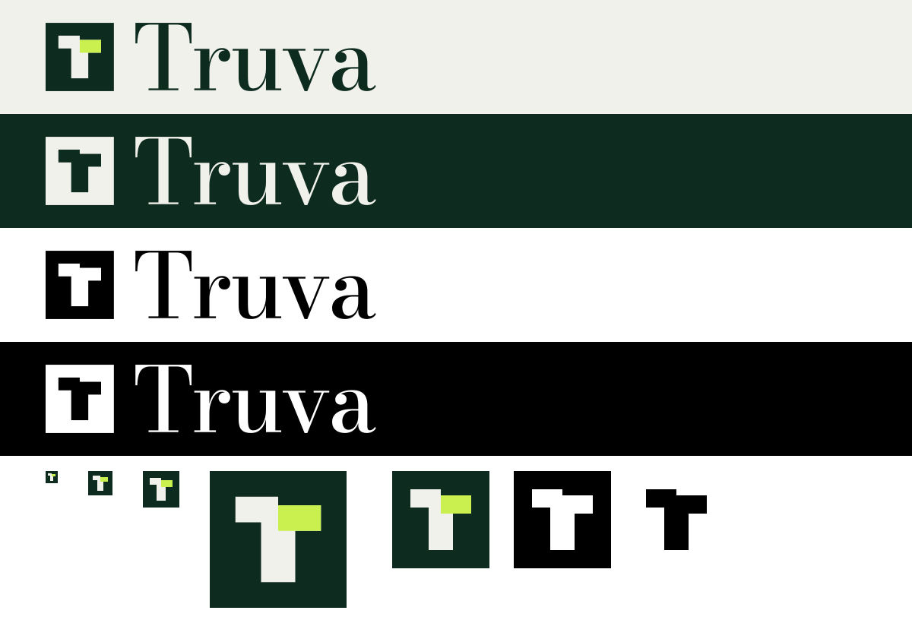

# Truva logo

**The mark** is a T whose crossbar is two legs meeting on one stem: the payment leg (left) and the delivery
leg (right). The delivery leg sits one step lower because it lands after payment; both rest on a single stem,
the settled record. It is drawn on a 16-pixel grid (every edge on a whole pixel at 16 px), so it stays sharp
as a favicon. **The wordmark** is "Truva" in Bodoni Moda 500, tracked −3%, converted to outlines.

| File | Use |
| --- | --- |
| `truva-mark.svg` | Primary mark: app icon, favicon, avatars |
| `truva-lockup.svg` | Mark + wordmark on light backgrounds |
| `truva-lockup-on-dark.svg` | Mark + wordmark on dark backgrounds |
| `truva-lockup-black.svg`, `truva-lockup-white.svg` | One-colour lockups (print, stamps, embossing) |
| `truva-mark-black.svg`, `truva-mark-white.svg` | One-colour marks (tile) |
| `truva-glyph-*.svg` | The T alone, no tile (ink, black, white) |
| `truva-wordmark*.svg` | Wordmark alone |
| `truva-mark-512.png` | Raster mark for platforms that need PNG |

**Colours:** ink `#0E2B20`, paper `#F1F1EC`, seal lime `#C9F04F` (the delivery leg only).

**Rules:** keep clear space of half the tile on every side; don't use the mark below 16 px or the lockup below
24 px tall; don't recolour the legs separately in one-colour versions, rotate, add effects or gradients, or
set the wordmark in another typeface. Regenerate everything with `node build-logo.mjs <outDir>` (needs
`opentype.js`, `@fontsource/bodoni-moda` and `sharp`).
